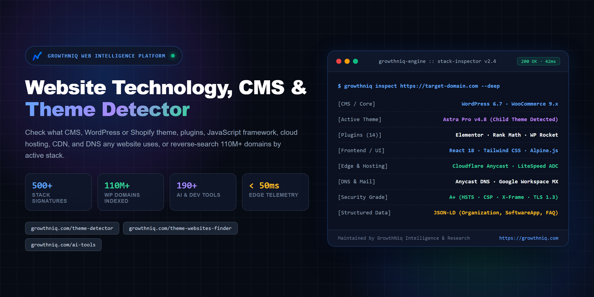
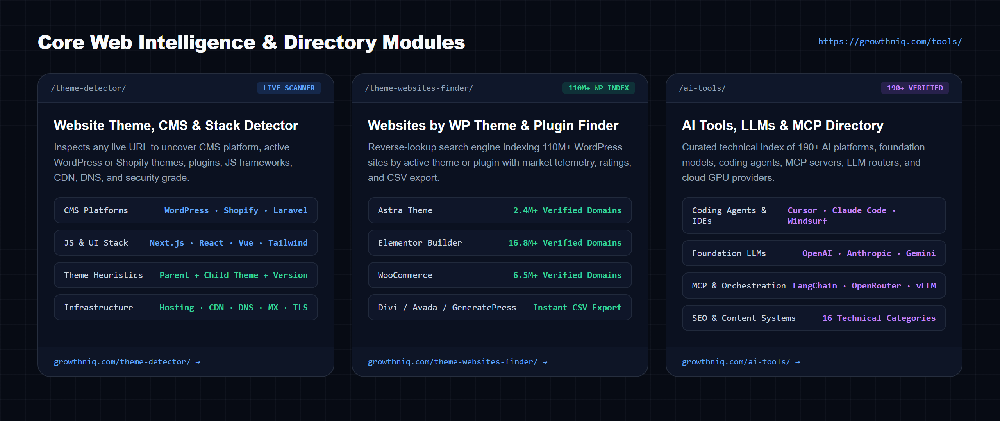
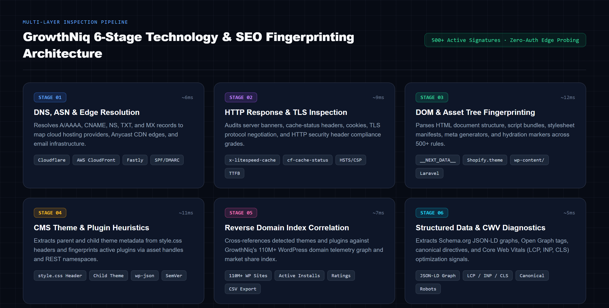
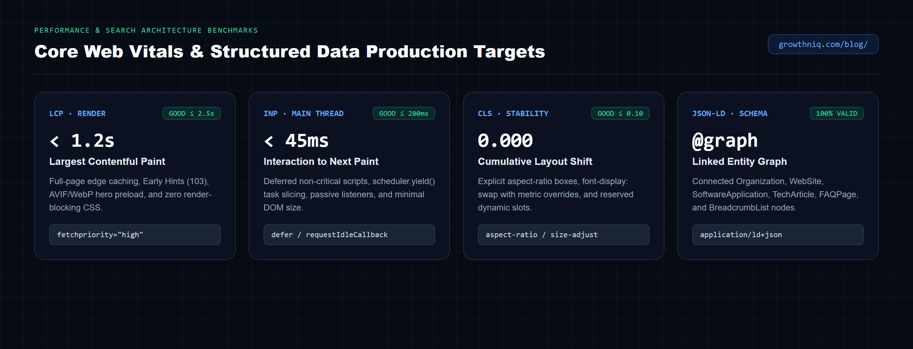

<p align="center">
  <a href="https://growthniq.com/theme-detector/">
    
  </a>
</p>

<h1 align="center">Website Technology Detector, CMS &amp; Theme Checker &amp; Reverse Stack Lookup</h1>

<p align="center">
  <b>Check What CMS, WordPress or Shopify Theme, Plugins, JS Framework, Hosting, CDN &amp; DNS Any Website Uses · 110M+ Reverse Domain Index · 190+ AI Tools</b><br>
  <sub>Maintained by <a href="https://growthniq.com/about/">GrowthNiq Intelligence &amp; Research</a> · Lead Architect: <a href="https://muhammadabid.com/">Muhammad Abid</a> (<a href="https://github.com/V3n0mSh3ll">@V3n0mSh3ll</a>)</sub>
</p>

<p align="center">
  <a href="https://growthniq.com/theme-detector/"></a>
  <a href="https://growthniq.com/theme-detector/"></a>
  <a href="https://growthniq.com/theme-websites-finder/"></a>
  <a href="https://growthniq.com/ai-tools/"></a>
  <a href="https://growthniq.com/blog/"></a>
  <a href="LICENSE"></a>
</p>

<p align="center">
  <a href="https://growthniq.com/theme-detector/"><b>Website Technology &amp; CMS Detector</b></a> ·
  <a href="https://growthniq.com/theme-websites-finder/"><b>Websites by WP Theme &amp; Plugin Finder</b></a> ·
  <a href="https://growthniq.com/ai-tools/"><b>190+ AI Tools &amp; MCP Directory</b></a> ·
  <a href="https://growthniq.com/tools/"><b>All Web Intelligence Tools</b></a> ·
  <a href="https://growthniq.com/blog/"><b>Engineering Guides</b></a>
</p>

---

## What Is This Repository?

**`website-technology-detector`** is the official open-reference architecture, signature specification, and technical documentation suite for **[GrowthNiq](https://growthniq.com/)** — a real-time **Website Technology Detector, CMS Checker, WordPress &amp; Shopify Theme Detector, Reverse Domain Lookup Engine (110M+ Websites), and Verified AI Tools Directory**.

Whether you want to check **what technology a website is built with**, inspect **what WordPress theme and plugins a site is using**, identify a **Shopify theme and installed apps**, find **who hosts a website**, or search **millions of live websites using a specific theme or plugin**, GrowthNiq executes multi-signal inspection in under 50ms with zero registration required.

<p align="center">
  <a href="https://growthniq.com/tools/">
    
  </a>
</p>

---

## High-Intent Stack Inspection Use Cases

| What You Want to Check | Live GrowthNiq Tool | What Gets Detected |
| :--- | :--- | :--- |
| **What technology is a website built with?** | **[Website Tech Stack Detector](https://growthniq.com/theme-detector/)** | 500+ signatures across CMS, JS frameworks (Next.js, React, Vue, Nuxt, Astro), server software, analytics, and payment gateways |
| **What CMS is this website using?** | **[Website CMS Detector](https://growthniq.com/theme-detector/)** | WordPress, Shopify, Laravel, Magento, Adobe Experience Manager, Webflow, Wix, Squarespace, Drupal, Ghost, Django, Rails, ASP.NET |
| **What WordPress theme &amp; plugins is that site using?** | **[WordPress Theme &amp; Plugin Detector](https://growthniq.com/theme-detector/)** | Active parent theme, custom child theme, version number, author URI, marketplace link, and active frontend/REST plugins |
| **What Shopify theme &amp; apps is a store running?** | **[Shopify Theme &amp; App Detector](https://growthniq.com/theme-detector/)** | `Shopify.theme` name, Theme Store ID, OS 2.0 schema version, and installed storefront apps |
| **Find websites using a WordPress theme or plugin** | **[Websites by WP Theme &amp; Plugin Finder](https://growthniq.com/theme-websites-finder/)** | Reverse-lookup 110M+ WordPress domains using Astra, Avada, Divi, GeneratePress, Elementor, WooCommerce, Rank Math, with CSV export |
| **Who hosts this website &amp; what CDN/DNS is active?** | **[Hosting, CDN &amp; DNS Lookup](https://growthniq.com/theme-detector/)** | Cloud host, Anycast CDN edge (Cloudflare, Fastly, CloudFront, Vercel), LiteSpeed cache status, DNS nameservers, and MX email provider |
| **Compare AI coding agents, LLMs &amp; MCP servers** | **[190+ AI Tools &amp; MCP Directory](https://growthniq.com/ai-tools/)** | 190+ verified AI tools, foundation models, coding IDEs (Cursor, Claude Code, Windsurf), MCP servers, and cloud GPU providers |

---

## Core Intelligence Platforms &amp; Live Web Utilities

<table>
<tr>
<td width="50%" valign="top">

### 1. [Website Theme, CMS &amp; Technology Detector](https://growthniq.com/theme-detector/)
Browser-based alternative to Wappalyzer, BuiltWith, and WhatsThatTheme that inspects any live URL in real time:
- **CMS &amp; Core Platform Detection**: WordPress, Shopify, Laravel, Magento, Adobe Experience Manager, Webflow, Wix, Squarespace, Drupal, Ghost, Django, Ruby on Rails, and ASP.NET.
- **WordPress &amp; Shopify Theme Fingerprinting**: Detects active parent themes, custom child themes, version numbers, author URIs, and ThemeForest/WordPress.org marketplace metadata.
- **Plugin &amp; App Detection**: Identifies active WordPress plugins, Shopify apps, e-commerce modules, and frontend script bundles.
- **Hosting, CDN, DNS &amp; Security Grade**: Maps cloud hosting providers, CDN edges, DNS nameservers, MX email gateways, TTFB latency, HTTP security header grades (`HSTS`, `CSP`, `X-Frame-Options`), and JSON-LD `@graph` entities.

**Launch Detector**: [https://growthniq.com/theme-detector/](https://growthniq.com/theme-detector/)

</td>
<td width="50%" valign="top">

### 2. [Websites by WordPress Theme &amp; Plugin Finder](https://growthniq.com/theme-websites-finder/)
Reverse technology search engine indexing **110M+ WordPress domains** by active theme or plugin signature:
- **Reverse Keyword &amp; Marketplace Lookup**: Search any WordPress theme or plugin (*Astra*, *Avada*, *Divi*, *GeneratePress*, *Hello Elementor*, *Elementor*, *WooCommerce*, *Rank Math*, *WP Rocket*).
- **Direct URL Extraction**: Paste any ThemeForest or WordPress.org theme/plugin URL to inspect live production deployments.
- **Market Telemetry &amp; Adoption Metrics**: View verified active website counts, historical download telemetry, star ratings, and official license links.
- **Instant CSV Dataset Export**: Download verified live domain lists for competitive market research and stack benchmarking.

**Launch Reverse Finder**: [https://growthniq.com/theme-websites-finder/](https://growthniq.com/theme-websites-finder/)

</td>
</tr>
<tr>
<td width="50%" valign="top">

### 3. [AI Tools, LLMs, Coding Agents &amp; MCP Directory](https://growthniq.com/ai-tools/)
Curated software intelligence directory tracking **190+ verified AI platforms** across **16 technical categories**:
- **Foundation Models &amp; Inference Routers**: OpenAI, Anthropic Claude, Google Gemini, DeepSeek, Mistral, Groq, OpenRouter, Together AI, Fireworks AI, and vLLM.
- **AI Coding Agents &amp; Developer IDEs**: Cursor, Claude Code, Windsurf, GitHub Copilot, Devin, Aide, and autonomous code review pipelines.
- **MCP Servers &amp; Agent Frameworks**: Model Context Protocol (MCP) integrations, LangChain, LlamaIndex, CrewAI, AutoGen, and vector databases.
- **SEO, Research &amp; Content Systems**: Verified pricing models, API availability, context window telemetry, and side-by-side capability ratings.

**Explore AI Directory**: [https://growthniq.com/ai-tools/](https://growthniq.com/ai-tools/)

</td>
<td width="50%" valign="top">

### 4. [Web Intelligence Hub &amp; Tool Submissions](https://growthniq.com/tools/)
Centralized command hub for web stack inspection, software discovery, and engineering research:
- **[Unified Tools Directory](https://growthniq.com/tools/)**: Direct access to all live inspection engines, reverse lookup indexes, and technical directories.
- **[Suggest a Tool or Signature](https://growthniq.com/suggest-a-tool/)**: Submit new CMS signatures, WordPress plugins, or AI developer platforms for engineering verification.
- **[HTML Sitemap &amp; Architecture Index](https://growthniq.com/sitemap/)**: Complete hierarchical index of all tools, category hubs, and technical documentation.

**Open Intelligence Hub**: [https://growthniq.com/tools/](https://growthniq.com/tools/)

</td>
</tr>
</table>

---

## Multi-Signal Stack Fingerprinting Architecture

<p align="center">
  <a href="https://growthniq.com/theme-detector/">
    
  </a>
</p>

### Detection Coverage Matrix (500+ Active Signatures)

| Telemetry Layer | Signatures | Primary Inspection Vectors | Verification Target |
| :--- | :---: | :--- | :--- |
| **CMS &amp; E-Commerce Platforms** | `85+` | Generator meta tags, REST API discovery headers (`x-pingback`, `api.w.org`), cart endpoints (`/cart.js`), session cookies (`laravel_session`) | WordPress, WooCommerce, Shopify, Laravel, Magento, Drupal, Webflow, Ghost |
| **WordPress Themes (Parent &amp; Child)** | `120+` | `/wp-content/themes/{slug}/style.css` header blocks (`Theme Name`, `Template`, `Version`, `Author URI`), body class tokens | Astra, Divi, Avada, GeneratePress, Kadence, Blocksy, OceanWP, Hello Elementor |
| **WordPress Plugins &amp; Modules** | `160+` | Enqueued script/style handles, `/wp-content/plugins/{slug}/` asset paths, `/wp-json/` namespace registration, inline JS globals | Elementor, Rank Math, Yoast SEO, WP Rocket, LiteSpeed Cache, WooCommerce, ACF |
| **JavaScript &amp; UI Frameworks** | `55+` | Hydration payloads (`__NEXT_DATA__`, `__NUXT_DATA__`), custom elements (`astro-island`), bundler chunk manifests, CSS utility tokens | Next.js, React, Vue, Nuxt, Astro, SvelteKit, Angular, Alpine.js, Tailwind CSS, Livewire |
| **Edge CDN, Cloud Hosting &amp; DNS** | `50+` | `Server`, `Via`, `cf-ray`, `x-litespeed-cache`, `x-vercel-id`, `x-amz-cf-id`, CNAME chains, NS records, and MX email gateways | Cloudflare, LiteSpeed ADC, Vercel, AWS CloudFront, Fastly, Kinsta, WP Engine, Cloudways |
| **Security &amp; Structured Data** | `35+` | `Strict-Transport-Security`, `Content-Security-Policy`, `X-Frame-Options`, `Referrer-Policy`, `Permissions-Policy`, `application/ld+json` | HTTP Security Grade (`A+` to `F`), TLS 1.3 negotiation, Schema.org `@graph` completeness |

---

## Technical Fingerprinting Reference

Below is a concise reference of the multi-signal heuristics documented in [`signatures/stack-fingerprints.json`](signatures/stack-fingerprints.json) and executed by the [GrowthNiq Website Theme, CMS &amp; Technology Detector](https://growthniq.com/theme-detector/):

### 1. WordPress Parent &amp; Child Theme Header Extraction (`style.css`)

```http
GET /wp-content/themes/astra-child/style.css HTTP/2
Host: target-domain.com
User-Agent: Mozilla/5.0 (compatible; GrowthNiqInspector/2.4; +https://growthniq.com/theme-detector/)
```

```css
/*
Theme Name:   Astra Child
Theme URI:    https://wpastra.com/
Template:     astra
Version:      4.8.2
Author:       Brainstorm Force
Author URI:   https://wpastra.com/about/
Text Domain:  astra-child
*/
```

- When the `Template:` directive is present, GrowthNiq resolves both the active **Child Theme** (`astra-child`) and the underlying **Parent Framework** (`astra`) by probing `/wp-content/themes/{Template}/style.css`.
- Read the complete technical breakdown: **[How to Check What WordPress Theme and Plugins a Website Is Using](https://growthniq.com/how-to-detect-wordpress-theme-and-plugins/)**.

### 2. High-Signal HTTP &amp; DOM Stack Signatures

```yaml
# Cloudflare + LiteSpeed Full-Page Edge Cache
HTTP Headers:
  server: cloudflare
  cf-cache-status: HIT
  x-litespeed-cache: hit
  x-turbo-charged-by: LiteSpeed

# Next.js App Router / React Hydration Markers
DOM Selectors:
  - script#__NEXT_DATA__[type="application/json"]
  - script[src*="/_next/static/chunks/"]

# Shopify Storefront & Theme Object
DOM & Global Variables:
  - window.Shopify.theme = { name: "Dawn", id: 142859239652, schema_name: "Dawn", schema_version: "15.0.0" }
  - link[href*="cdn.shopify.com/s/files/"]

# Laravel + Livewire / Inertia Stack
Cookies & Attributes:
  - Set-Cookie: XSRF-TOKEN=...; laravel_session=...
  - div[wire:id], div[wire:initial-data], div#app[data-page]
```

---

## Core Web Vitals &amp; Structured Data Engineering Benchmarks

<p align="center">
  <a href="https://growthniq.com/blog/">
    
  </a>
</p>

Full production audit checklist available in [`checklists/technical-seo-cwv-checklist.md`](checklists/technical-seo-cwv-checklist.md).

### Production Performance Budgets

| Metric | Google Threshold | GrowthNiq Target | Primary Engineering Optimization | Reference Guide |
| :--- | :---: | :---: | :--- | :--- |
| **TTFB** (Time to First Byte) | `< 800ms` | **`< 90ms`** | Full-page edge HTML caching, Tiered Cache topology, HTTP/3 (QUIC), OPcache + Redis Object Cache | [Speed Up WordPress Guide](https://growthniq.com/speed-up-wordpress-website/) |
| **LCP** (Largest Contentful Paint) | `<= 2.5s` | **`< 1.2s`** | `fetchpriority="high"` on hero image, AVIF/WebP compression, critical inline CSS, 103 Early Hints | [Fix Slow LCP Score Guide](https://growthniq.com/fix-lcp-score/) |
| **INP** (Interaction to Next Paint) | `<= 200ms` | **`< 45ms`** | Defer non-essential JS, break long tasks (`> 50ms`) via `scheduler.yield()`, passive event listeners | [INP &amp; CLS Optimization Guide](https://growthniq.com/inp-cls-guide/) |
| **CLS** (Cumulative Layout Shift) | `<= 0.10` | **`0.000`** | Explicit `width`/`height` attributes, CSS `aspect-ratio` containers, metric-matched webfont fallbacks | [INP &amp; CLS Optimization Guide](https://growthniq.com/inp-cls-guide/) |
| **JSON-LD Entity Graph** | Valid Syntax | **Linked `@graph`** | Connected `Organization`, `WebSite`, `SoftwareApplication`, `TechArticle`, `FAQPage`, `BreadcrumbList` | [Schema Markup Explained](https://growthniq.com/schema-markup-explained/) |

---

## Complete Engineering Guides &amp; Technical Research Index

All guides are published and maintained by the engineering and editorial team at **[GrowthNiq Blog](https://growthniq.com/blog/)**:

### 1. Stack Detection, Technical SEO &amp; Core Web Vitals

| Technical Guide | Core Focus |
| :--- | :--- |
| **[How to Check What WordPress Theme and Plugins a Website Is Using](https://growthniq.com/how-to-detect-wordpress-theme-and-plugins/)** | Inspecting `style.css` headers, child themes, asset handles, REST API namespaces, and DOM fingerprints |
| **[The Complete Technical SEO Audit Checklist for WordPress Sites (15-Step Guide)](https://growthniq.com/technical-seo-audit-checklist-2026/)** | Crawl budget, canonicalization, XML sitemaps, `robots.txt`, HTTP headers, and indexation diagnostics |
| **[How to Fix a Slow LCP Score in WordPress](https://growthniq.com/fix-lcp-score/)** | Eliminating render-blocking assets, optimizing TTFB, preloading LCP elements, and edge caching |
| **[Core Web Vitals: INP &amp; CLS Optimization Guide](https://growthniq.com/inp-cls-guide/)** | Main-thread task yielding, JavaScript deferral, layout stability, and zero-CLS CSS containment |
| **[How to Speed Up a WordPress Website (Complete Performance Guide)](https://growthniq.com/speed-up-wordpress-website/)** | LiteSpeed/Cloudflare caching, database query optimization, object caching, and asset minification |
| **[Schema Markup Explained: JSON-LD Implementation Guide](https://growthniq.com/schema-markup-explained/)** | Building linked `@graph` structured data for `Article`, `FAQPage`, `SoftwareApplication`, and `Organization` |
| **[Complete Image SEO Guide: Next-Gen Formats, Alt Text &amp; Compression](https://growthniq.com/complete-image-seo-guide/)** | AVIF/WebP conversion, responsive `srcset` sizing, lazy-loading thresholds, and Google Images indexing |

### 2. Search Architecture, Keyword Intelligence &amp; On-Page SEO

| Technical Guide | Core Focus |
| :--- | :--- |
| **[SEO for Beginners: Complete Guide to Rank on Google in 2026](https://growthniq.com/seo-for-beginners-complete-guide-to-rank-on-google-in-2026/)** | End-to-end search engine architecture, crawl-index-rank pipeline, and topical authority |
| **[On-Page SEO Techniques for Content Publishers](https://growthniq.com/on-page-seo-techniques/)** | Semantic HTML hierarchy, internal link equity distribution, entity salience, and search intent alignment |
| **[Keyword Research Guide 2026: Topical Maps &amp; Search Intent](https://growthniq.com/keyword-research-guide-2026/)** | Semantic keyword clustering, SERP feature analysis, and high-intent query mapping |
| **[How to Find Low-Competition Keywords That Actually Rank](https://growthniq.com/find-low-competition-keywords/)** | Uncovering underserved technical queries, zero-volume long-tail gems, and SERP weakness signals |
| **[How to Write Catchy, High-CTR Headlines for Search &amp; Discovery](https://growthniq.com/how-to-write-catchy-headlines/)** | Title tag pixel budgets, emotional vs. technical modifiers, and SERP click-through rate testing |

### 3. Authority Acquisition, Link Building &amp; Traffic Systems

| Technical Guide | Core Focus |
| :--- | :--- |
| **[The Ultimate Link Building Guide for Technical &amp; Content Sites](https://growthniq.com/ultimate-link-building-guide/)** | Earning editorial backlinks via free interactive tools, original data studies, and digital PR |
| **[How to Earn High-Authority Backlinks Without Guest Posting](https://growthniq.com/backlinks-without-guest-posting/)** | Linkable utility assets, open-source documentation, and natural citation frameworks |
| **[What Makes a Backlink Good? Evaluating Link Quality &amp; Relevance](https://growthniq.com/what-makes-a-backlink-good/)** | Topical alignment, placement context, anchor text distribution, and link velocity signals |
| **[How to Drive Sustainable Organic Traffic to Your Website](https://growthniq.com/drive-traffic-to-your-blog/)** | Multi-channel organic acquisition, search intent capture, and content refresh cycles |

### 4. AI Engineering Workflows, Publishing &amp; Platform Monetization

| Technical Guide | Core Focus |
| :--- | :--- |
| **[Best AI Writing &amp; Research Tools for Publishers (Free &amp; Paid)](https://growthniq.com/best-ai-writing-tools-for-bloggers-in-2026-free-paid/)** | Comparative evaluation of LLMs, research copilots, and semantic optimization platforms |
| **[How to Use AI for Content Creation Without Losing Technical Depth](https://growthniq.com/how-to-use-ai-for-content-creation/)** | Human-in-the-loop editorial pipelines, code verification, and original research integration |
| **[How to Fact-Check AI-Generated Content &amp; Prevent Hallucinations](https://growthniq.com/fact-check-ai-content/)** | Primary source verification, citation auditing, and technical accuracy standards |
| **[Best ChatGPT Prompts for Technical Writers &amp; Publishers](https://growthniq.com/best-chatgpt-prompts-for-bloggers/)** | Structured system prompts for outline engineering, schema generation, and content auditing |
| **[Advanced ChatGPT Prompt Frameworks for Content Operations](https://growthniq.com/chatgpt-prompts-bloggers/)** | Multi-step prompt chaining for keyword clustering, semantic briefs, and technical editing |
| **[How to Start a Technical Blog in 2026 (Complete Step-by-Step Guide)](https://growthniq.com/how-to-start-a-blog-in-2026-complete-beginners-guide-step-by-step/)** | Domain architecture, high-speed hosting setup, WordPress hardening, and publishing workflow |
| **[Google AdSense Approval Checklist: Technical &amp; Policy Readiness](https://growthniq.com/google-adsense-approval-checklist/)** | Consent Mode v2 CMP compliance, mandatory policy pages, site quality, and navigation structure |
| **[Understanding Google AdSense RPM &amp; Revenue Optimization](https://growthniq.com/adsense-rpm-2026/)** | Tier-1 geography targeting, viewability optimization, CLS-safe ad slots, and niche RPM factors |
| **[AdSense vs. Affiliate Marketing: Revenue Architecture Comparison](https://growthniq.com/adsense-vs-affiliate-marketing/)** | Comparing programmatic display yield vs. high-intent software affiliate conversions |
| **[Affiliate Marketing Guide for Technical Publishers](https://growthniq.com/affiliate-marketing-for-bloggers/)** | FTC-compliant product reviews, comparison matrices, and conversion-focused architecture |
| **[How to Sell Digital Products &amp; Developer Assets Online](https://growthniq.com/sell-digital-products-on-blog/)** | Licensing, checkout infrastructure, and monetizing audience trust with first-party products |
| **[Building &amp; Scaling Digital Product Funnels on WordPress](https://growthniq.com/sell-digital-products-blog/)** | High-converting product landing pages, automated delivery, and recurring revenue systems |

---

## Topic Hubs &amp; Platform Governance

- **Topic Hubs**:
  [Technical SEO](https://growthniq.com/category/technical-seo/) ·
  [Core Web Vitals](https://growthniq.com/category/core-web-vitals/) ·
  [On-Page SEO](https://growthniq.com/category/on-page-seo/) ·
  [Keyword Research](https://growthniq.com/category/keyword-research/) ·
  [Link Building](https://growthniq.com/category/link-building/) ·
  [Search Engine Optimization](https://growthniq.com/category/seo/) ·
  [Blogging &amp; Publishing](https://growthniq.com/category/blogging/)
- **Corporate &amp; Editorial Governance**:
  [About GrowthNiq](https://growthniq.com/about/) ·
  [Editorial Policy](https://growthniq.com/editorial-policy/) ·
  [Editorial AI Use Policy](https://growthniq.com/editorial-ai-use-policy/) ·
  [Corrections Policy](https://growthniq.com/corrections-policy/) ·
  [Privacy Policy](https://growthniq.com/privacy-policy/) ·
  [Terms of Service](https://growthniq.com/terms/) ·
  [HTML Sitemap](https://growthniq.com/sitemap/) ·
  [Contact](https://growthniq.com/contact/)

---

## Repository Structure

```text
website-technology-detector/
├── assets/
│   ├── growthniq-banner.png           # Website Technology, CMS & Theme Detector hero banner
│   ├── platform-modules.png           # 3-module visual showcase (/theme-detector, /theme-websites-finder, /ai-tools)
│   ├── detection-architecture.png     # 6-stage multi-signal stack & SEO fingerprinting pipeline
│   └── cwv-seo-benchmarks.png         # Core Web Vitals (LCP, INP, CLS) & JSON-LD production targets
├── checklists/
│   └── technical-seo-cwv-checklist.md # Production verification checklist for WordPress & CWV
├── signatures/
│   └── stack-fingerprints.json        # Open reference of CMS, framework, and CDN detection vectors
├── LICENSE                            # MIT License
└── README.md                          # Complete platform documentation & engineering guide index
```

---

## Maintainer &amp; Attribution

Architected and maintained by **[GrowthNiq Intelligence &amp; Research](https://growthniq.com/about/)**.

- **Founder &amp; Principal Engineer**: [Muhammad Abid](https://muhammadabid.com/) ([@V3n0mSh3ll](https://github.com/V3n0mSh3ll))
- **Live Platform**: [https://growthniq.com/](https://growthniq.com/)
- **License**: [MIT License](LICENSE)